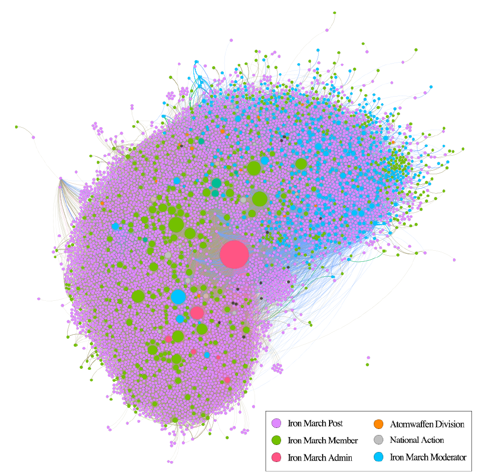
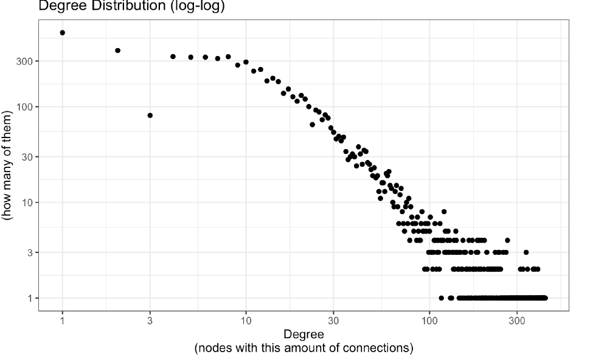
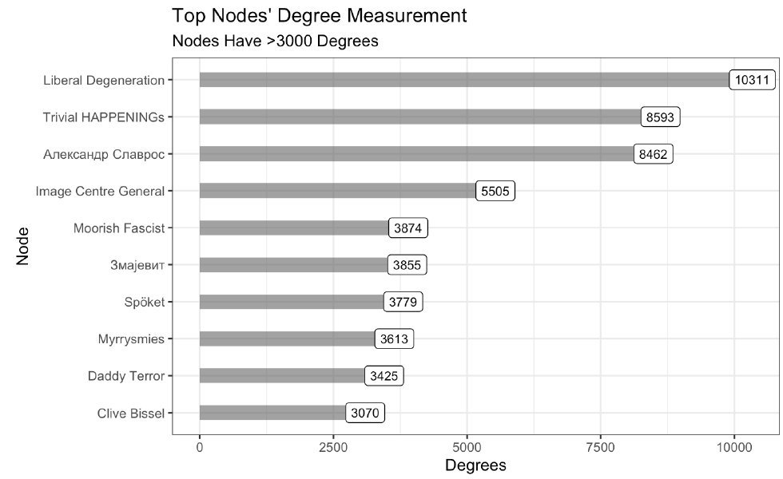
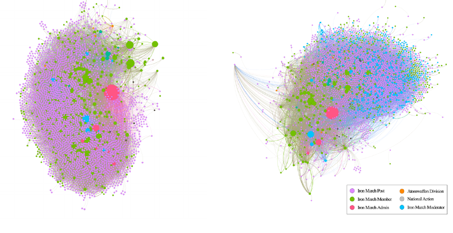
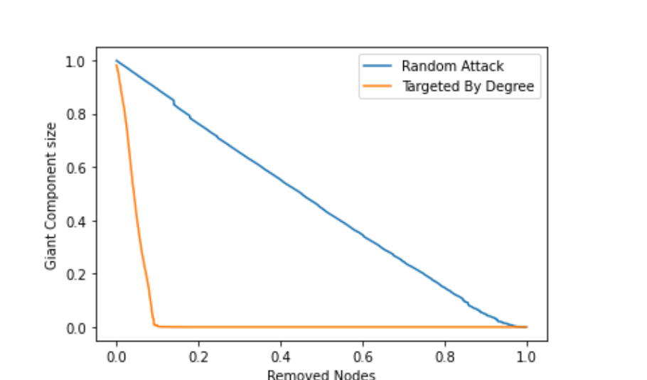
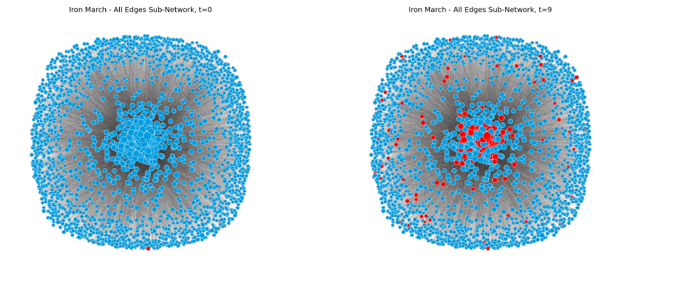
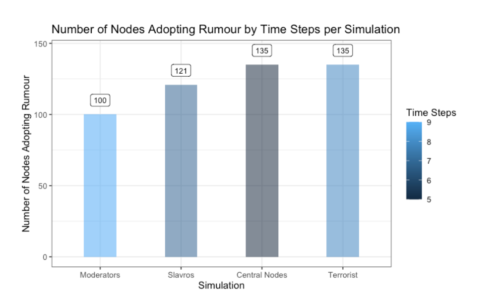
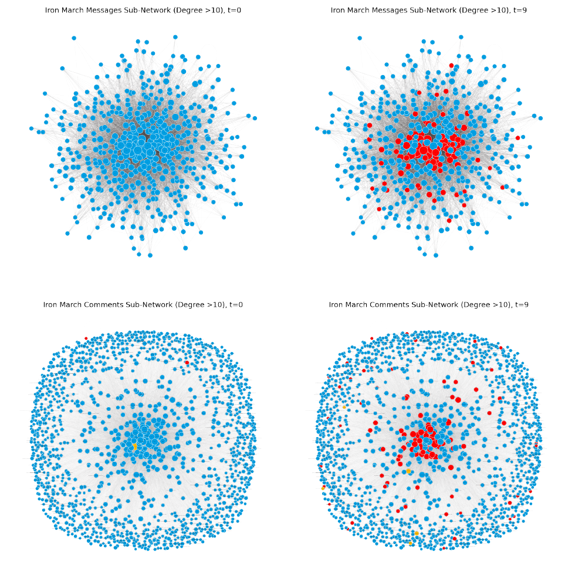
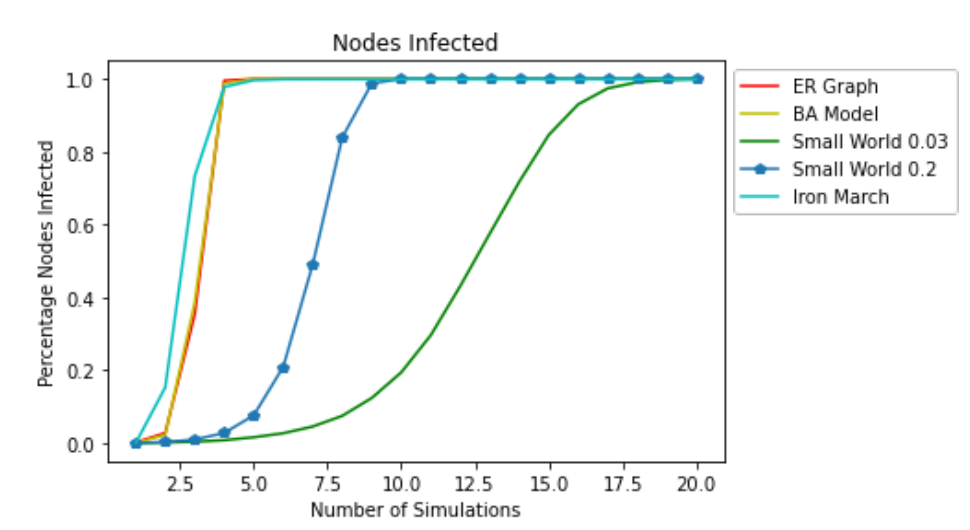

# Iron March — Network Disruption Strategies for a Far-Right Web-Forum

**Targeted removal of the top 15% of nodes by degree collapsed the Iron March
network. Seeding a rumour at one central node infected 6% of the network in
7 steps.**

This repository holds the anonymised datasets and analysis from my MSc
thesis (Technological University Dublin, MSc Computer Science — Data
Science, 2022). It asks what drives change in centrality in the Iron
March network, and whether "lemonising the market" — spreading a rumour
that a member is a law-enforcement informant — can disrupt it.

Iron March was a neo-Nazi web-forum whose database was leaked publicly
in November 2019. The forum bred groups including National Action and
Atomwaffen Division. The data here comes from that leak, anonymised
for publication — see [ETHICS.md](ETHICS.md).

## Research question

1. What are the main drivers of change in centrality measures in the
   Iron March network?
2. Can a "lemon" — a rumour that a member is a law-enforcement
   informant — be used as a method of network disruption?

## Method

- **Datasets** built from the leaked forum exports — the original dataset
  is [Iron March 'Fascist Social Network'
  Dataset](https://www.kaggle.com/davidpham/iron-march-fascist-social-network-dataset)
  (David Pham, Kaggle, 2019; 99 CSV files from the November 2019 leak):
  a members table (1,207 members) and private messages (20,514 messages
  in 3,217 threads). Published here anonymised — see
  [data/DATA_DICTIONARY.md](data/DATA_DICTIONARY.md). How the raw
  files were cleaned into these datasets is in
  [data/PREPROCESSING.md](data/PREPROCESSING.md).
- **Social network analysis**: interaction networks built from forum
  posts, comments and private messages; degree, betweenness, closeness
  and alpha centrality tracked over time; community structure via
  modularity. Analysis in R (igraph) and Gephi 0.9.3 for the descriptive work.
  The original analysis notebook is in this repo —
  [`analysis/iron_march_analysis.Rmd`](analysis/iron_march_analysis.Rmd),
  with a section-by-section guide in
  [`analysis/README.md`](analysis/README.md).
- **Change over time**: t-tests, Wilcoxon and Mann–Whitney U tests on
  centrality measures around external events (including the 2016 US
  presidential election) and across sub-networks.
- **Disruption experiments** in Python/NetworkX (Jupyter) — the thesis used NetworkX 2.8.4:
  - *Resilience*: random node removal vs targeted removal by degree.
  - *Simple contagion*: the rumour spreading like a virus.
  - *Complex contagion*: the rumour spreading only when a node hears
    it from multiple trusted contacts, seeded four ways — the founder,
    known terrorists, moderators, and the most central nodes.

## The network

The full network, 2011–2017, is **7,415 nodes** (members and posts) with **187,140 edges** (messages, comments and post creation). It is a **winner-takes-all, scale-free network**: the degree distribution follows a super-linear power law, so a few early nodes became super-hubs and every new node preferentially attached to them. It is *not* a small-world network — density is 0.003 and the clustering coefficient just 0.017, with an average distance of 3.271 steps and a diameter of 8. Modularity of 0.310 shows sub-communities exist.



*Figure 4.2 from the thesis: Iron March network created in Gephi spanning the entire lifespan of the network.*



*Figure 4.1 from the thesis: degree distribution shows a super-linear power law indicating a "winner-takes all" dynamic.*

**Influence is concentrated in a small core.** The most connected nodes are two posts — "Liberal Degeneration" (10,311 degrees) and "Trivial HAPPENINGs" (8,593) — followed by the founder Slavros (8,462), who also has the highest outdegree and the highest betweenness centrality (1,009,578). Slavros reaches **71.3% of all nodes within two steps**, while only 4.25% of nodes can reach him — he is the bridge the whole network hangs on, sitting at the centre of its longest path (diameter 8). That asymmetry is sharpest for terrorists: **93.7% of nodes can be reached by a terrorist, but only 4.61% of nodes can reach one**, with Slavros and the big posts acting as the conduits. By alpha centrality, the most influential members are newer moderators (Tyler, Primavera, Blitz — all joined 2016–2017), who gain influence through their high-degree neighbours.



*Figure 4.3 from the thesis: most central nodes in the Iron March network.*

**The network changed from within, not from outside.** Comparing the network before and after 2016 shows moderators appearing among a flurry of new posts — and the change was driven by friendship formation between sub-networks, not by the 2016 US presidential election, which did not significantly move any centrality measure.



*Figure 4.6 from the thesis: before (left) and after (right) networks created in Gephi show appearance of moderators among a flurry of new posts in 2016.*

## Disruption findings

- **The network is not resilient to targeted attack.** Removing nodes
  at random degrades the giant component roughly linearly. Removing
  the highest-degree nodes first collapses it immediately — the
  network falls apart after **15% of nodes** are removed.

  

  *Figure 4.7 from the thesis: the Iron March network is vulnerable to
  a targeted attack on highly central nodes.*

- **A rumour seeded at one central node works.** In the complex
  contagion simulations on a 2,176-node, 37,279-edge subgraph:

  | Seed strategy | Nodes adopting the rumour | Time to complete |
  |---|---|---|
  | Moderators (10 central mods) | 100 (5%) | t=9 |
  | Founder (Slavros) | 121 (6%) | t=7 |
  | Central nodes | 135 (6%) | t=5 |
  | Terrorists | 135 (6%) | t=8 |

  The founder seed is the best practical strategy: one highly
  connected, trusted node spreads the rumour fast and with authority.
  Telling more people first does not help — the 10-moderator seed
  infected fewer nodes and took longest.

  

  *Figure 4.10 from the thesis: t=0 and t=9 of the Slavros simulation, where 6% of nodes adopt the rumour.*

  

  *Figure 4.14 from the thesis: nodes infected with the rumour per
  simulation, colour scaled by time steps to complete.*

- **Messages beat comments for speed, comments for reach.** In the
  separate models, the rumour reached 87 of 500 nodes (17%) via
  messages, peaking at t=8, and 111 of 1,561 nodes (7%) via comments,
  peaking at t=9. Simple contagion infects the whole network in
  under five simulations — and the network behaves like a random or
  scale-free graph, not a small-world one.

  

  *Figure 4.9 from the thesis: time-step cascading simulation of how the rumour spreads via different links.*

  

  *Figure 4.8 from the thesis: 20 simulations of the spread of a rumour in the same fashion as a virus across five different graphs derived from the Iron March network.*

## Repository contents

```
├── README.md
├── LICENSE
├── requirements.txt
├── ETHICS.md                  # source, anonymisation, intended use
├── assets/                    # thesis figures used in this README
│   ├── fig4-1-degree-distribution.png
│   ├── fig4-2-network.png
│   ├── fig4-3-top-nodes.png
│   ├── fig4-6-before-after.png
│   ├── fig4-7-resilience.png
│   ├── fig4-8-simple-contagion.png
│   ├── fig4-9-cascade.png
│   ├── fig4-10-slavros.png
│   └── fig4-14-simulations.png
├── analysis/                  # original R analysis (see analysis/README.md)
│   ├── README.md              # section-by-section guide to the notebook
│   └── iron_march_analysis.Rmd  # the thesis analysis notebook, 4,784 lines
├── data/
│   ├── DATA_DICTIONARY.md     # every column, what changed and why
│   ├── PREPROCESSING.md       # Kaggle → cleaned datasets → anonymised files
│   ├── members_anonymised.csv # 1,207 members, hashed IDs, no emails/names
│   ├── messages_anonymised.csv# 20,514 messages, structure only, no text
│   ├── edges.csv              # 4,663 aggregated sender → receiver pairs
│   └── 2016_mentions.csv      # keyword mention counts by half-year (33 rows)
├── scripts/
    ├── anonymise.py           # raw export → anonymised files
    └── verify.py              # checks the anonymised files for leaks
```

## Reproduce the analysis

```bash
git clone https://github.com/DanWaugh/ironmarch.git
cd ironmarch
python3 scripts/verify.py
```

The raw forum exports the original R notebook reads are not in this
repo: they contain members' email addresses, usernames and full
private-message text, so they can't be published. That means the
original notebook can't be re-run end-to-end from here — but everything
downstream of the anonymised files can, and the anonymised files in
`data/` support exactly that.

The anonymised files were made with `scripts/anonymise.py` and checked
with `scripts/verify.py` — both published so the method is auditable,
but they can't be re-run from this repo alone: they need the cleaned
source files (see `data/PREPROCESSING.md`) and the private salt, both
held outside the repo. Reproduction itself
runs through the original R notebook
(`analysis/iron_march_analysis.Rmd`) — see `analysis/README.md` for
what it can and can't do from here.

What you can reproduce today: read the R notebook, run
`scripts/verify.py` against the anonymised files, run the network
analysis in R on the anonymised files (see "Using the anonymised files
in R" in `analysis/README.md`), or download the Kaggle dataset and run
the R notebook on the raw files (see `data/PREPROCESSING.md`).

## Data and ethics

The raw export contained email addresses, usernames and full
private-message text. None of that is published here: identifiers
are salted SHA-256 hashes, message text and thread titles are
removed, and timestamps are half-year buckets. The repo also includes
`data/2016_mentions.csv`, a derived table of keyword mention counts
by half-year — counts only, no message content. Full detail in
[data/DATA_DICTIONARY.md](data/DATA_DICTIONARY.md) and
[ETHICS.md](ETHICS.md). Do not attempt to re-identify anyone in
these files.

## Citation

Waugh, D. (2022). *Social Network Analysis of the Iron March
web-forum*. MSc thesis, Technological University Dublin.

## Licence

MIT — see [LICENSE](LICENSE).
